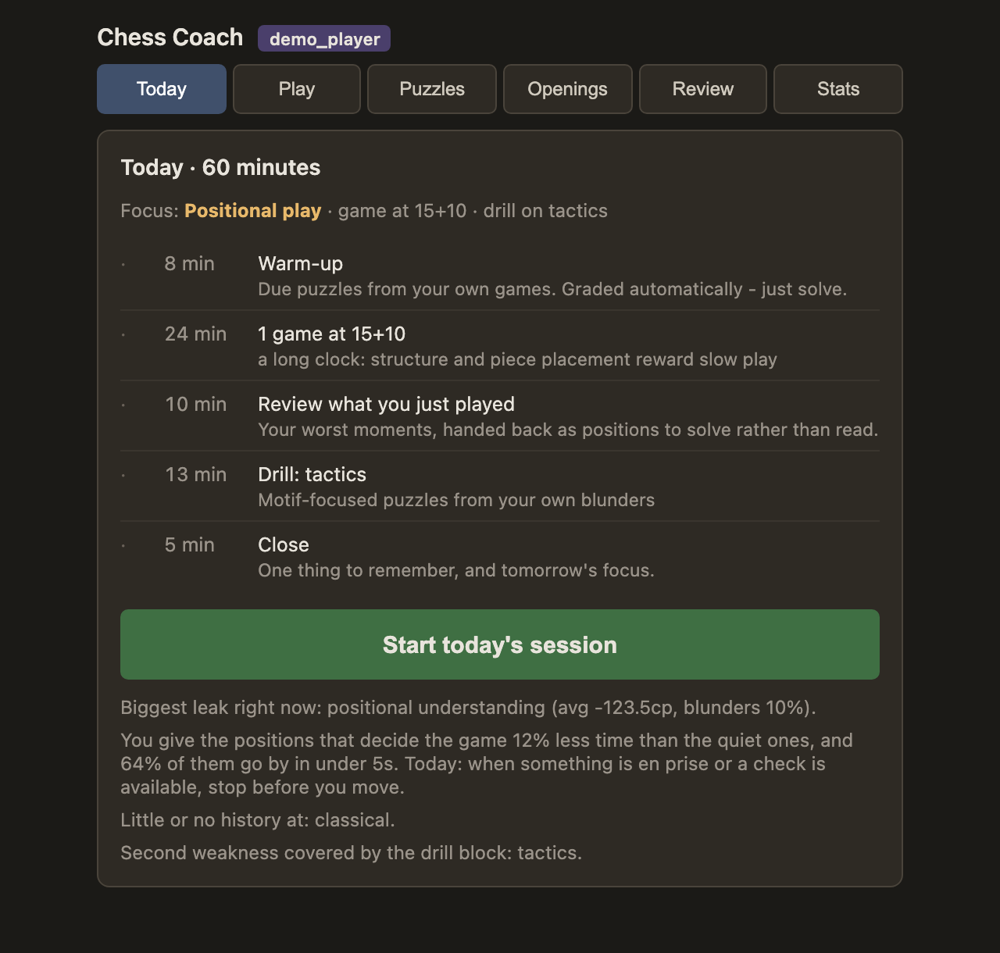
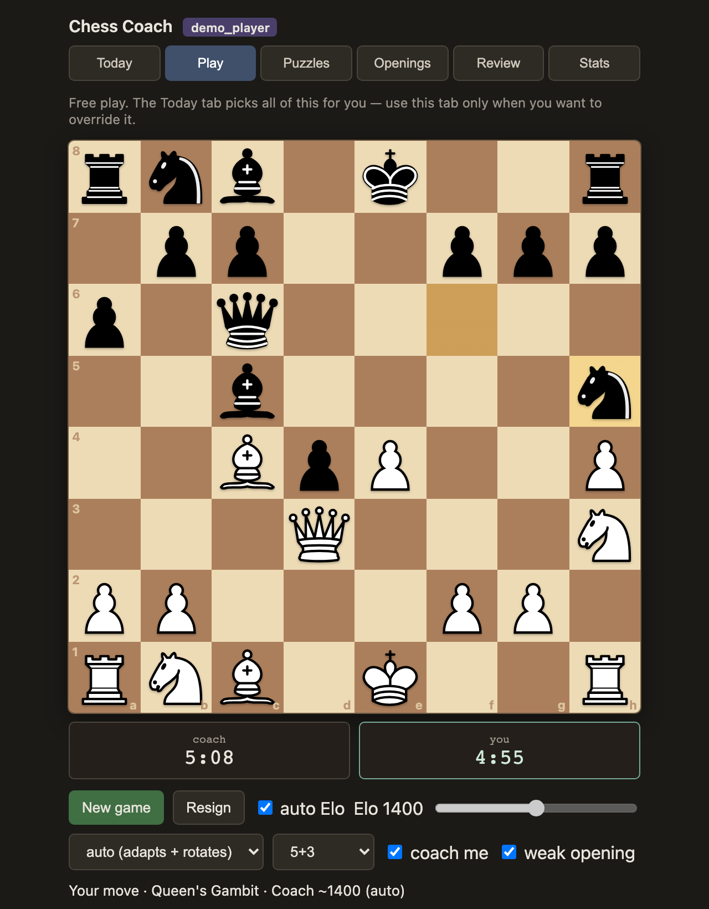
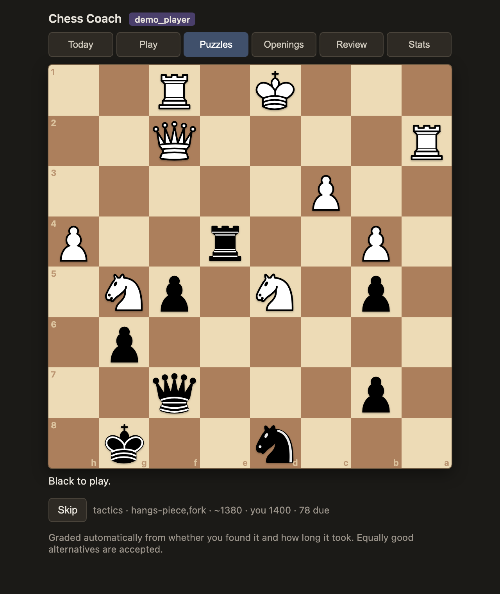

# Chess Coach

**A chess engine written from scratch, and a coach that builds a weakness profile from your own online games and plans a daily training hour around it.**

The engine was built for the [AI Chessathon](https://aichessathon.com): pure Python, one CPU core, 50 MB, no network. The coach is a local web app that pulls your Lichess and Chess.com games, has Stockfish grade every move, works out *what kind* of mistake you actually make (not just how many), and then spends an hour a day on it: puzzles mined from your own blunders, games against a bot tuned to your level that steers into your weak spots, and drills for the endgames and openings you keep losing.



<table>
<tr>
<td width="50%"></td>
<td width="50%"></td>
</tr>
<tr>
<td align="center"><sub>Coached game: the bot plays at your level and picks fights in your weak areas</sub></td>
<td align="center"><sub>Puzzle mined from your own game, graded and scheduled automatically</sub></td>
</tr>
</table>

<sub>Screenshots use synthetic demo games (`make demo`), not anyone's real account.</sub>

## Highlights

- **A real search, in pure Python.** Iterative-deepening negamax with a transposition table, PVS, aspiration windows, null-move and reverse-futility pruning, late-move reductions, SEE-pruned quiescence, mate-distance pruning and in-search repetition. Checked against perft positions and a tactics suite. ([`engine/search.py`](engine/search.py))
- **Strength changes are measured, not felt.** A self-play harness runs SPRT between engine versions from a curated opening set, so an "improvement" has to win games before it lands. ([`tests/selfplay/`](tests/selfplay))
- **Packaged for a constrained sandbox.** `make package` builds `agent.zip` from a whitelist of files; a smoke test then plays full games under a simulated 120 s + 0.5 s clock, asserting every move is legal, within the response limit, and never flags. ([`submission/`](submission))
- **A five-pillar weakness model.** Every move is classified as opening, tactics, positional, endgame, or *finding a move in a quiet position*, routed by what the position was rather than how big the error turned out to be. Rankings are decision-weighted so they can't be won on volume alone. ([`coach/profile/`](coach/profile))
- **Sparring at a target Elo that really is that Elo.** Stockfish scores every root move; the bot samples from them with a strength curve, a bias toward your weak pillar, and an opening picker that widens your repertoire. A calibration command compares the bot's expected centipawn loss with human rating bands, and caught low-end anchors that were far too weak. ([`coach/sparring/`](coach/sparring), [`coach/profile/calibration.py`](coach/profile/calibration.py))
- **Spaced-repetition puzzles from your own mistakes.** Positions are mined from your games, kept only if the best move is unambiguous (≥80 cp ahead of the second best), graded from outcome and solve time rather than self-assessment, and difficulty-targeted at an 80% success rate. ([`coach/puzzles/`](coach/puzzles))
- **Endgame drills judged on the result.** A Lucena has several winning moves, so each drill carries a goal (win or hold) and any move that keeps it is accepted, checked by Stockfish rather than against a stored line. ([`coach/drills/`](coach/drills))
- **Measurement bugs found and fixed, with the reasoning kept.** cp-loss differenced from two searches at the same budget; raw mate scores kept apart from clamped ones so mate puzzles can be mined at all; progress reported as motif recurrence per hundred decisions rather than a noisy average. See the [decisions log](docs/PLAN.md#7-design-decisions).
- **Opt-in LLM narration.** Reviews read as plain English from deterministic templates by default. With `COACH_LLM=1` and `ANTHROPIC_API_KEY` set, Claude turns the engine's lines into prose; it never picks a move. ([`coach/coaching/`](coach/coaching))

## Quick start

macOS with [Homebrew](https://brew.sh); on Linux, install `uv` and `stockfish` however you like.

```bash
brew install uv stockfish
git clone https://github.com/am318/chess-coach && cd chess-coach
make setup && make test        # Python 3.12 venv, then the test suite
make demo                      # a few minutes: synthetic games, analysed, in ./demo
make demo-serve                # then open http://localhost:8000
```

To use your own games instead: `cp coach.example.toml coach.toml`, add your Lichess / Chess.com usernames, then `python -m coach.cli serve --open`. `coach.toml` and `coach.db` are gitignored and stay on your machine.

## Architecture

| Module | What it does |
|---|---|
| `engine/` | The competition engine: search, classical eval, SEE, time management, opening-book and tablebase hooks. Imports nothing from `coach/`. |
| `submission/` | `agent.py` entry point, `build.py` (zip + checks), `smoke_test.py` (clocked harness contract). |
| `coach/ingest/` | Lichess, Chess.com and PGN import into SQLite. |
| `coach/analysis/` | Stockfish annotation, move classification, derived-field repair. |
| `coach/profile/` | Weakness model, progress metrics, bot calibration. |
| `coach/sparring/` | Target-Elo opponent, weakness steering, opening picker. |
| `coach/puzzles/`, `coach/drills/`, `coach/openings/` | Puzzle miner and solver, SRS scheduler, endgame and repertoire drills, opening trainer. |
| `coach/session/` | The daily-hour planner: picks blocks, time controls and targets from the profile. |
| `coach/server/`, `coach/web/` | FastAPI backend and a dependency-free browser UI. |

```
games ─▶ ingest ─▶ Stockfish analysis ─▶ classify ─▶ weakness profile ─┬▶ daily plan
                                                                       ├▶ sparring bot
                                                                       ├▶ puzzles + drills (SRS)
                                                                       └▶ review + progress
```

How a day with the coach works is in [docs/USAGE.md](docs/USAGE.md); the full design, config reference, endpoints and decisions log are in [docs/PLAN.md](docs/PLAN.md).

## Status

- **Engine:** roughly club level today: a hand-tuned PeSTO-style eval, no NNUE. It passes perft and tactics suites and beats a greedy 1-ply opponent 12–0 in self-play. Move generation is python-chess, which is the main speed limit.
- **Coach:** the daily loop is complete: sync, analyse, profile, plan, spar, puzzle, drill, review, progress. It is a single-user local app, with no accounts or hosting.
- **Next:** numba bitboard move generation, then an NNUE eval trained on the coach's own Stockfish labels, with SPSA tuning. After that, a model of the player's style so the sparring bot can anticipate them.
- **Soft spots:** the sparring bot's strength curve was calibrated on one corpus of games and needs more data at the extremes. Syzygy tablebases are too large to ship inside the 50 MB limit.

## Development

```bash
make test        # full suite; the Stockfish-dependent test skips if the binary is absent
make perft       # move-generator correctness only
make smoke       # simulated-clock harness check
make package     # build and verify agent.zip
make lint
```

To try changes without touching real data, point `COACH_TOML` and `COACH_DB` at throwaway files before running `python -m coach.cli serve`.

## License

MIT. Piece artwork is the Cburnett set (BSD-licensed option); see [LICENSE](LICENSE).
